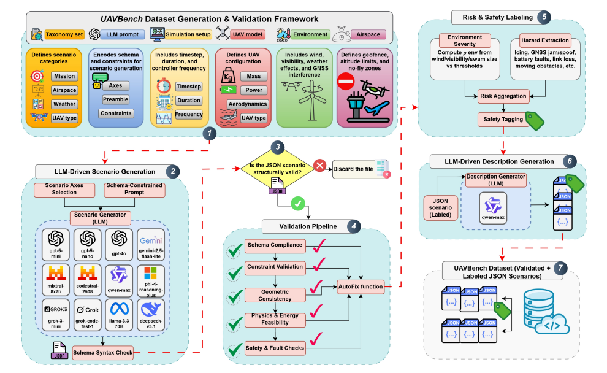
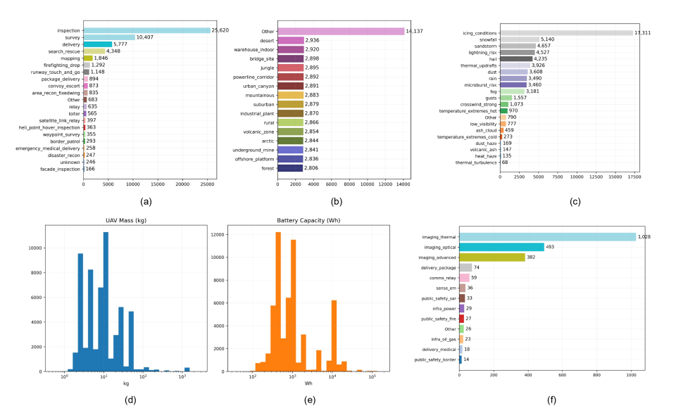
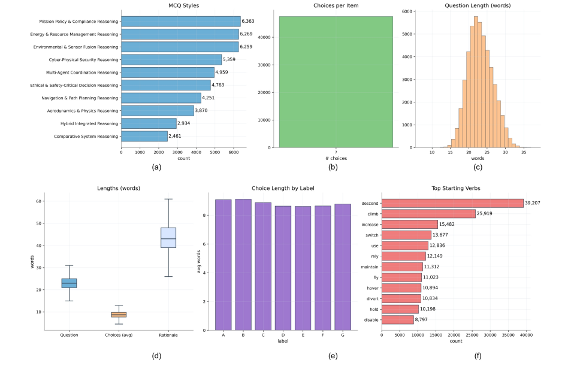
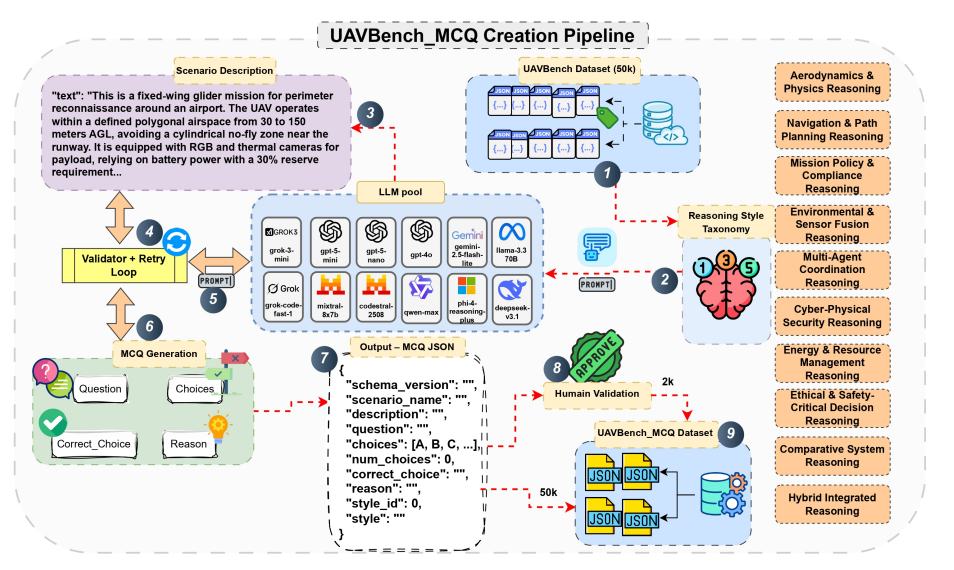
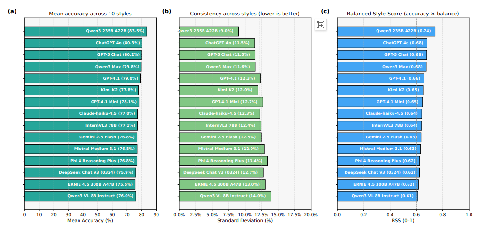

# [UAV+LLM] UAVBench: Benchmark Dataset for Autonomous Intelligent Drones System with Python Code

Summary: Autonomous airborne systems increasingly rely on large language models (LLMs) for task planning, perception, and decision-making, but the lack of standardized, grounded benchmarks limits systematic evaluation of their reasoning capabilities. To fill this gap, this paper proposes UAVBench—an open benchmark dataset consisting of 50,000 verified drone flight scenarios generated through classification-guided LLM engineering and multi-stage safety verification. Each scenario is encoded in a structured JSON architecture that includes task objectives, aircraft configurations, environmental conditions, and quantitative risk labels, providing a unified representation for drone operations across different domains. Building on this, UAVBench_MCQ, an extension module for inference, contains 50,000 multiple-choice questions covering ten cognitive and ethical reasoning types—from aerodynamics and navigation to multi-agent coordination and hybrid integration reasoning. This framework supports explainable, machine-verifiable assessments of specific cognitive abilities of drones in real operational scenarios. The paper evaluates 32 state-of-the-art LLMs (including GPT-5, ChatGPT 4o, Gemini 2.5 Flash, DeepSeek V3, Qwen3 235B, and ERNIE 4.5 300B) and finds that these models perform well in perception and policy reasoning but continue to face challenges in ethical perception and resource-constrained decision-making. UAVBench lays a foundation for reproducible, grounded benchmarking in the context of intelligent agents in autonomous airborne systems, driving the development of next-generation drone reasoning intelligence.
Introduction: Large Language Models (LLMs) are becoming powerful tools for enhancing the autonomy of unmanned aerial vehicles (UAVs). Recent research has increasingly explored integrating large language models into UAV systems to improve autonomy, decision-making capabilities, and communication efficiency. Several studies have shown that LLMs can enhance or replace traditional reinforcement learning and optimization frameworks, which are often limited by training complexity and low sample efficiency [1]. For example, LLMs have been applied in UAV network through hybrid decision-making frameworks, which combine discovery generation with structured knowledge graphs to achieve interpretable context-aware drone control [2]; another study used LLM-guided reinforcement learning to address the trade-off between security and energy efficiency in heterogeneous UAV networks, achieving enhanced secrecy rate and robust trajectory optimization [3]; similarly, contextual learning based on LLMs has been introduced into intelligent data collection and scheduling for UAV assisted networks, outperforming baseline strategies while also revealing its vulnerability to adversarial manipulation [4]; furthermore, evolutionary optimization has been utilized to assist LLMs, minimizing information timeliness loss in UAV assisted sensor networks, demonstrating superior routing efficiency under high node density conditions [5]. These advancements highlight the potential of LLMs to inject adaptability, interpretability, and semantic reasoning capabilities into the decision-making process of UAVs.
Beyond the autonomy of individual agents, large language models are also utilized in multi-agent unmanned aerial vehicle coordination and large-scale operation scenarios. Recent frameworks utilize iterative structured prompts to optimize multi-hop drone deployment, reducing computational overhead while maintaining near-optimal performance in network backhaul scenarios [6,7]. Additionally, studies have demonstrated that contextual learning based on large language models is effective in wildfire monitoring flight resource allocation—real-time scheduling is crucial for minimizing delays and data failures [8]. Researchers have also proposed a hierarchical architecture combining high-altitude platforms and airborne drones with large language models for three-dimensional airways systems, providing strategic access control and tactical maneuverability [9]. In the field of group intelligence, a role-adaptive framework driven by large language models enhances collaboration through semantic communication and dynamic role switching, improving the task coverage and generalization capabilities of multi-drone systems [10]. Similarly, urban trajectory planning methods combine deep reinforcement learning (DRL) with large language model inference to ensure safe, efficient, and compliant operations in low-altitude economic airspace [11]. These studies collectively indicate that large language models are not merely auxiliary tools but are becoming core enablers for intelligent, explainable, and scalable autonomy across different task scenarios in unmanned aerial vehicles.
Building intelligent agents capable of understanding natural language commands and converting them into navigation actions remains a core challenge in the field of artificial intelligence [13]. Although visual-language navigation (VLN) has been widely studied in ground robotics, the aviation domain introduces greater complexity. UAVs must operate in continuous three-dimensional environments with high degrees of freedom, variable heights, dynamic obstacles, as well as dynamic environmental conditions such as wind and lighting changes [14]. These factors make path planning, spatial reasoning, and language grounding much more challenging than on the ground systems. Moreover, airborne navigation requires fine control over attitude, speed, and stability; even minor errors can lead to mission failure or collisions. Therefore, directly adapting ground-based visual-language navigation methods—which are typically optimized for discrete plane motions—cannot capture the continuous physical driving characteristics of airborne movements or the inherent real-time decision constraints of flight [15].
Despite increasing research attention, existing drone visual-language navigation benchmarks and datasets still have limitations in terms of realism, task diversity, and physical grounding. Many datasets rely on simplified discrete actions, static environments, or low-fidelity simulations, neglecting the core continuous control challenges of drone operation [7]. This lack of physical and semantic richness hinders the development of fully embodied airborne intelligence. To fill this gap, specialized platforms and datasets are needed that integrate real flight dynamics, multimodal perception, and task-level reasoning. Such resources can not only more accurately simulate drone flight behavior but also promote research on complex reasoning and language grounding decisions under real-world constraints. In response to these limitations, this paper proposes Unified Benchmarks like UAVBench, which combine scene-level realism with structured reasoning evaluation, paving the way for end-to-end research on autonomous, language-guided airborne navigation.
Drones are increasingly being applied in various fields, including disaster response, agriculture, environmental monitoring, traffic observation, and inspection of energy infrastructure. However, most tasks still rely on manual remote control, which is time-consuming, error-prone, and costly [16]. Therefore, developing autonomous drone intelligent agents capable of perceiving, reasoning, and acting in complex environments is a key research objective. Compared to ground or indoor intelligent agents, drones face unique challenges such as operating in large-scale dynamic three-dimensional environments, high data collection costs, and the need for well-defined aerial embodied tasks. Addressing these challenges requires specialized simulators, datasets, and evaluation frameworks to support the training and benchmarking of drone embodied intelligence [17].
In addition to task execution, the autonomy of unmanned aerial vehicles (UAVs) also needs to evolve from fine-grained instruction-based navigation towards advanced goal-oriented cognition. Emerging methods such as Object Navigation demonstrate the potential of semantically driven navigation - intelligent agents reaching critical goals through abstract targets rather than detailed step-by-step instructions [18]. Although Object Navigation has been explored in indoor ground scenarios, its application in outdoor aerial environments remains insufficient. Meanwhile, human-like situated cognition - processing continuous first-person visual streams for positioning, reasoning, and navigation - is fundamentally absent in current UAV research. The urban airspace features vertical maneuverability, dynamic obstacles, and dense semantic complexity, presenting new challenges for autonomous navigation. To promote the development of this field, it is essential to establish systematic, standardized, and open benchmarks to evaluate the cognitive capabilities possessed by UAVs and achieve robust, scalable autonomy in real-world scenarios [19].
This study revolves around the following research questions, aiming to explore how structured, physical grounding of drone scenarios and reason-based evaluation frameworks can drive the development of autonomous aerial intelligence:
•  
RQ1: How does the unified architecture and taxonomy-driven generation framework ensure that large-scale drone scenarios meet the requirements of autonomous flight intelligent benchmark tests in terms of physical consistency, safety perception, and semantic diversity?
•  
RQ2: Methods for systematically validating and labeling auto-generated drone scenarios to ensure physical feasibility, architectural compliance, and interpretability can include but are not limited to:
•  
RQ3: Designing structured reasoning tasks based on validated drone scenarios to assess and compare cognitive, ethical, and operational decision-making capabilities in autonomous airborne systems.
•  
RQ4: How do different reasoning types (covering physical, navigational, ethical, and hybrid domains) affect the accuracy, generalization, and reliability of agents performing drone-related reasoning tasks?
•  
RQ5: To what extent do different model architectures and training paradigms influence consistency and grounded reasoning performance across diverse drone task scenarios?
To address these research questions, this paper proposes UAVBench—an open benchmark dataset for generating drone flight scenarios using large language models, aimed at evaluating and training AI models for intelligent agents in autonomous airborne systems. UAVBench integrates scene generation, validation, risk labeling, and reasoning into a single framework, systematically generating structured and physically consistent drone tasks. Each scenario is represented as a validated JSON specification, containing drone configuration, environment, mission objectives, airspace geometry, and safety constraints. The dataset incorporates a multi-stage validation pipeline to ensure architectural compliance, physical feasibility, and risk-aware labeling, thereby supporting large-scale benchmark testing for autonomous flight intelligence. Additionally, this paper extends the dataset with UAVBench_MCQ—an inference-oriented benchmark for evaluating the cognitive, ethical, and operational decision-making capabilities of large language models in drone scenarios. The core contributions of this study are as follows:
1  
Uniform drone scenario architecture: Proposing a structured, mathematically defined architecture that represents each drone task as a tuple containing simulation dynamics, aircraft configuration, environmental conditions, mission planning, and safety constraints, ensuring consistency, physical validity, and interoperability across different drone applications.
Taxonomy-guided scene generation: Develop a taxonomy-guided large language model prompting mechanism to sample from factorized spaces of task types, airspace configurations, weather conditions, drone designs, and payload categories to generate a large-scale dataset UAVBench containing 50,000 verified, physically consistent drone flight scenarios. This dataset is rich in semantics and safe perceptions, suitable for training and evaluation.
3  
4  
UAVBench_MCQ (Structured Reasoning Benchmark): Proposes UAVBench_MCQ, an extension of UAVBench for reasoning, comprising 50,000 multiple-choice questions derived from validated scenario systems. Each question follows a standardized JSON schema and falls under one of ten reasoning types: aerodynamics and physics, navigation and path planning, policy and compliance, environmental perception, multi-agent coordination, information-physical security, energy management, ethical decision-making, comparative systems, and hybrid integrated reasoning. This framework ensures grounded authenticity, structural integrity, and logical consistency, supporting reproducible large-scale reasoning evaluations.
5  
Large Language Model Evaluation: A benchmark evaluation of 32 state-of-the-art large language models (including GPT-5, ChatGPT 4.0, Gemini 2.5 Flash, DeepSeek V3, Qwen3 235B, ERNIE 4.5 300B and Mistral Medium 3.1) on the UAVBench_MCQ benchmark. The evaluation covers physical, navigation, ethical and hybrid cognition dimensions of autonomous drones, finding that models perform exceptionally well in perception and policy reasoning but continue to face persistent challenges in multi-agent coordination, energy management and ethical decision-making.
Method Introduction UAVBench's core method revolves around the generation and inference benchmark construction of datasets, mainly including the following four key links:
1. Unified Drone Scenario Architecture Design
The architecture of the unified drone scenario is represented using a mathematically defined structured JSON, representing each drone scenario as a tuple that encompasses 16 core modules: scene name and random seed, simulation parameters (time step, simulation steps, controller update frequency), drone configuration (type, mass, energy, maximum speed, payload, etc.), environmental conditions (weather, wind speed, visibility, electromagnetic interference, etc.), airspace constraints (altitude range, geographic fences), initial state of generation, task objectives (task type, waypoints, path pattern, time budget), background traffic, obstacles, group teammates, control space, safety thresholds, fault injection, communication constraints, etc. The architecture ensures physical realism through explicit mathematical constraints (e.g., energy consumption model, aerodynamic equations) and operational feasibility.
2. Classification-Driven Scenario Generation
The construction of four core classifications (scene types, airspace types, weather types, drone types) guides the generation of scenarios. Discrete elements are organized into meaningful categories: scene types include patrolling, delivery, reconnaissance, search and rescue; airspace types are divided into urban, natural terrain, infrastructure corridors, and special constraints areas; weather types include precipitation, wind, visibility, ice formation, and define severity scores; drone types are categorized into multi-rotor, rotary wing, fixed-wing, hybrid wings. By incorporating axis tuples (scene, airspace, weather, drone type, random number) into large language models' prompts, along with architectural constraints, scenarios are generated to balance diversity and effectiveness.
3. Multi-stage verification and risk labeling design
4. UAVBench_MCQ - The inference benchmark generation transforms verified scenarios into standardized multiple-choice questions, covering ten types of reasoning (aerodynamics and physics, navigation and path planning, policy and compliance, etc.). Each multiple-choice question follows a JSON structure, including the scenario description, question, options, correct answer, reason, and metadata. The generation process adheres to strict constraints: based on scene facts, complete in structure, only one correct option, distractors that are locally reasonable but violate relevant constraints, length limits (question ≤ 28 words, options ≤ 14 words), and ethical questions use a seven-option code for safety priority. Through multi-stage generation and validation, ensure the quality of questions, support large-scale machine automatic scoring.
Conclusion This paper presents UAVBench, a large-scale open benchmark dataset for evaluating the reasoning capabilities of autonomous intelligent drone systems. UAVBench consists of 50,000 flight scenarios that have been physically verified and safety labeled, using a unified JSON architecture to encode core elements of cross-domain drone operations. It also includes the UAVBench_MCQ extension module, which provides 50,000 structured multiple-choice questions covering ten types of cognitive and ethical reasoning, achieving a comprehensive and reproducible evaluation of specific intelligent capabilities in drones.
The evaluation results of 32 state-of-the-art large language models indicate that cutting-edge models have achieved near-human performance in areas such as perception, physical reasoning, and policy compliance. However, they still exhibit significant deficiencies in safety-critical tasks such as multi-agent coordination, energy management, and ethical trade-offs. These findings highlight the advantages and limitations of current large language models in the application of complex aerial autonomous systems, providing direction for subsequent research.
UAVBench fills the gaps in existing benchmarks by standardizing scene generation, multi-stage validation, and structured reasoning assessments, offering a unified evaluation framework for the development of intelligent drones. Future research will further integrate multimodal sensor data, dynamic simulations, and temporal reasoning tasks to promote the construction of next-generation drone intelligence systems that are body-aware, trustworthy, and context-aware.

## Images

<!-- PAYMENT_BLOCK -->

## Get this dataset

- Payment link (Stripe): [Buy now](https://buy.stripe.com/3cs8yP7sY87d0vu9AB)
- Payment QR code: 

<!-- /PAYMENT_BLOCK -->
